<p align="center">
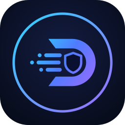
</p>

<h1 align="center">Digi Cyber</h1>

<div dir="rtl">

<p align="center"><b>اپ VPN دیجی سایبر</b> برای ویندوز، اندروید، مک و لینوکس<br>فقط لینک اشتراک‌تان را وارد کنید و با یک لمس به سریع‌ترین سرور وصل شوید.</p>

## ⬇️ دانلود

لینک‌های زیر همیشه آخرین نسخه را دانلود می‌کنند.

| سیستم | دانلود | توضیح |
| --- | --- | --- |
| 🪟 **ویندوز ۱۰ و ۱۱** (۶۴ بیتی) | [**Digi-Cyber-Setup.exe**](../../releases/latest/download/Digi-Cyber-Setup.exe) | همه‌ی کامپیوترهای ویندوزی |
| 🤖 **اندروید ۵ به بالا** | [**universal.apk**](../../releases/latest/download/Digi-Cyber-android-universal.apk) | اگر نمی‌دانید کدام را بگیرید؛ روی همه‌ی گوشی‌ها نصب می‌شود |
| | [arm64-v8a.apk](../../releases/latest/download/Digi-Cyber-android-arm64-v8a.apk) | بیشتر گوشی‌های این چند سال (حجم کمتر) |
| | [armeabi-v7a.apk](../../releases/latest/download/Digi-Cyber-android-armeabi-v7a.apk) | گوشی‌های قدیمی |
| 🍎 **مک** با تراشه‌ی Apple (M1 و جدیدتر) | [**mac-arm64.pkg**](../../releases/latest/download/Digi-Cyber-mac-arm64.pkg) | نسخه‌ی ۱۲ مک به بالا |
| 🍎 **مک** با پردازنده‌ی اینتل | [mac-x64.pkg](../../releases/latest/download/Digi-Cyber-mac-x64.pkg) | نسخه‌ی ۱۲ مک به بالا |
| 🐧 **اوبونتو، دبیان، مینت** | [amd64.deb](../../releases/latest/download/Digi-Cyber-linux-amd64.deb) — [arm64.deb](../../releases/latest/download/Digi-Cyber-linux-arm64.deb) | |
| 🐧 **فدورا، RHEL، openSUSE** | [x86_64.rpm](../../releases/latest/download/Digi-Cyber-linux-x86_64.rpm) — [aarch64.rpm](../../releases/latest/download/Digi-Cyber-linux-aarch64.rpm) | |
| 🐧 **آرچ، مانجارو** | [x64.pacman](../../releases/latest/download/Digi-Cyber-linux-x64.pacman) — [aarch64.pacman](../../releases/latest/download/Digi-Cyber-linux-aarch64.pacman) | |
| 📱 **آیفون و آیپد** | — | فعلاً نسخه‌ی iOS نداریم؛ لینک اشتراک را در برنامه‌های **Streisand** یا **Happ** وارد کنید. |

**مک من کدام است؟** در منوی Apple گزینه‌ی **About This Mac** را بزنید: اگر جلوی Chip نوشته شده Apple M1 (یا M2، M3 و…)، فایل arm64 را بگیرید؛ اگر جلوی Processor نوشته شده Intel، فایل x64 را.

همه‌ی نسخه‌ها و فایل `SHA256SUMS.txt` (برای بررسی سالم بودن فایل‌ها) در [صفحه‌ی Releases](../../releases) هستند.

## 🛠 نصب

**ویندوز:** فایل را اجرا کنید. اگر پیام «Windows protected your PC» آمد، روی **More info** و بعد **Run anyway** بزنید (فقط بار اول).

**اندروید:** فایل APK را باز کنید و یک بار اجازه‌ی نصب از این منبع را بدهید. اگر Play Protect هشدار داد، **More details** و بعد **Install anyway** را بزنید.

**مک:** فایل pkg را باز کنید. بار اول macOS جلوی آن را می‌گیرد: در **System Settings** بخش **Privacy & Security** را باز کنید و **Open Anyway** را بزنید. برای پروتکل OpenVPN روی مک، آن را با Homebrew نصب کنید.

**لینوکس:** در ترمینال و در پوشه‌ای که فایل را دانلود کرده‌اید:

</div>

```bash
# Ubuntu / Debian / Mint
sudo apt install ./Digi-Cyber-linux-amd64.deb
# Fedora / RHEL   (openSUSE: sudo zypper install ...)
sudo dnf install ./Digi-Cyber-linux-x86_64.rpm
# Arch / Manjaro
sudo pacman -U ./Digi-Cyber-linux-x64.pacman
# macOS, for OpenVPN only
brew install openvpn
```

<div dir="rtl">

## 🔑 ورود فقط با لینک اشتراک

نام کاربری لازم نیست. لینک اشتراکی را که در پیام تحویل سرویس گرفته‌اید در اپ بچسبانید و «ورود» را بزنید؛ اپ اکانت شما را خودش از روی اشتراک پیدا می‌کند.

- **اندروید:** لینک را بچسبانید، یا کد QR ورود را با دکمه‌ی «اسکن QR» بخوانید. اگر عکس کد روی همین گوشی است، «عکس QR» را بزنید.
- **ویندوز، مک، لینوکس:** لینک را در کادر بچسبانید. لینک‌های ورود `digicyber://` هم با یک کلیک اپ را باز می‌کنند و وارد می‌شوند.

هر پلنی که خریده‌اید با همان اشتراک در اپ کار می‌کند و هر دستگاه یکی از جاهای «تعداد دستگاه» اشتراک را می‌گیرد.

## ✨ امکانات

- همه‌ی پروتکل‌های سرویس: Xray (VLESS، VMess، Trojan، Shadowsocks و Hysteria 2)، WireGuard، OpenVPN و L2TP/IPsec (ویندوز و لینوکس)
- حالت خودکار که سریع‌ترین پروتکل و سرور جواب‌دهنده را انتخاب می‌کند
- کیل‌سوییچ، تونل‌زنی جداگانه برای برنامه‌ها، سایت‌های ایرانی بدون VPN، مسدود کردن تبلیغات و DNS دلخواه
- جلوگیری از نشت WebRTC و هماهنگی منطقه‌ی زمانی روی دسکتاپ
- حجم، زمان و دستگاه‌های اشتراک در یک نگاه؛ اشتراک هر ۱۰ دقیقه خودش به‌روز می‌شود
- اعلان‌های سرویس‌دهنده، و ارسال گزارش خطا به پشتیبانی از داخل اپ
- فارسی و انگلیسی، تم تیره و روشن

## 🛡 دانلود امن و حریم خصوصی

- فقط از **همین صفحه** یا لینکی که سرویس‌دهنده‌ی شما می‌فرستد دانلود کنید؛ فایلی که در گروه یا کانال دیگری دست‌به‌دست شده ممکن است دستکاری شده باشد.
- آدرس هیچ سروری داخل خود اپ نیست: سرورها، پروتکل‌ها و اطلاعیه‌ها فقط با لینک اشتراک خودتان می‌آیند.
- اپ برای ورود فقط لینک اشتراک، شناسه‌ی دستگاه، نام و نسخه‌ی سیستم عامل و نسخه‌ی اپ را می‌فرستد تا سقف دستگاه‌ها رعایت شود. گزارش خطا فقط وقتی فرستاده می‌شود که خودتان «گزارش خطا» را بزنید، و رمزها، کلیدها و لینک‌ها پیش از ارسال از آن حذف می‌شوند.

## 📸 تصاویر

</div>

<p align="center">
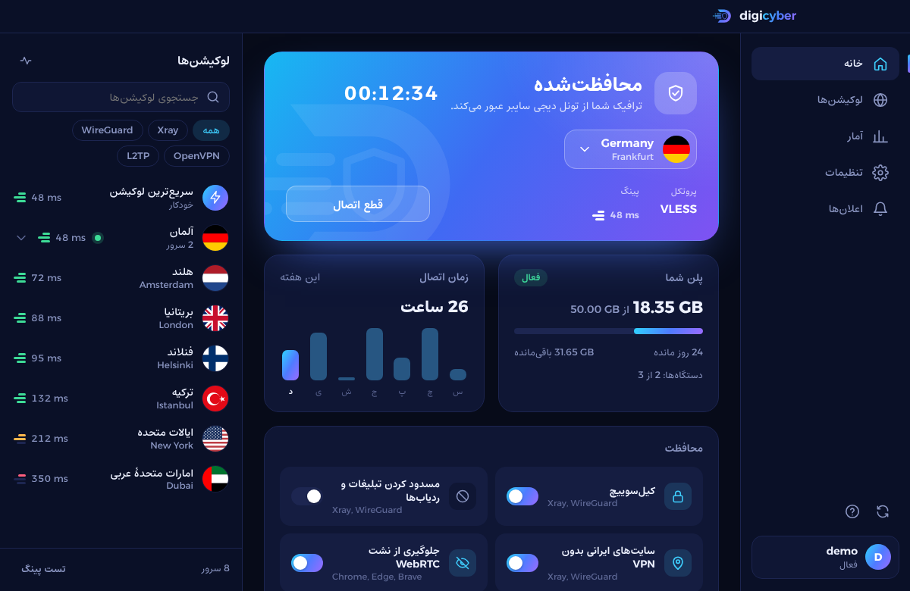
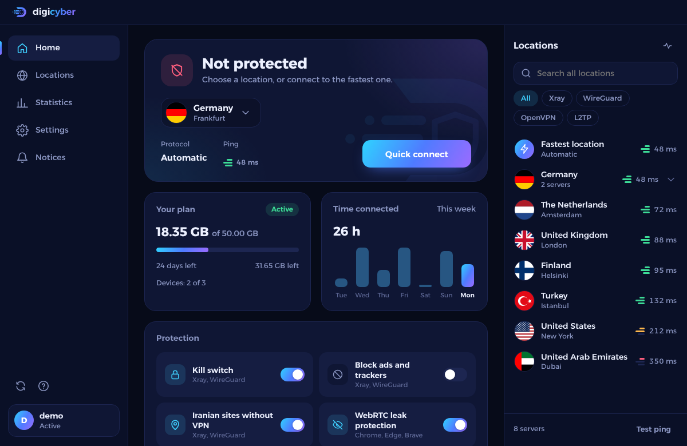
</p>
<p align="center">
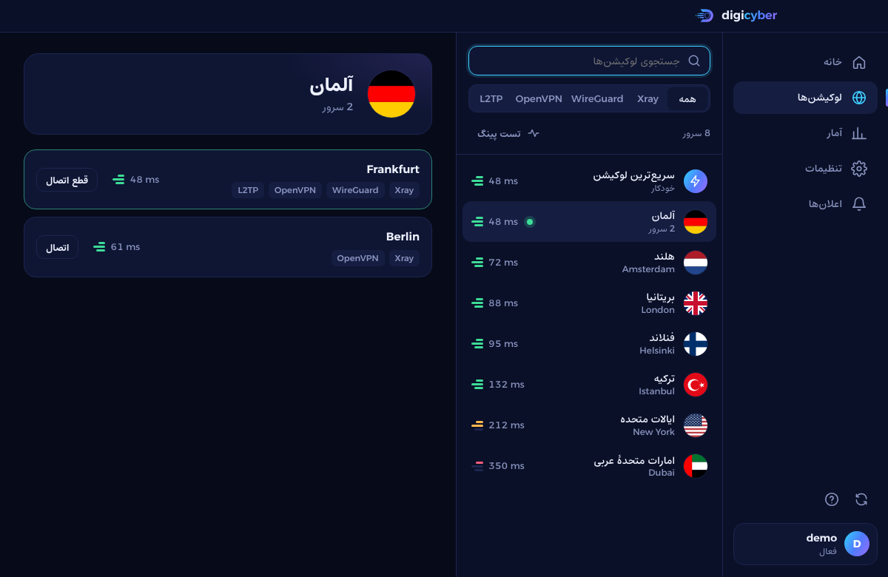
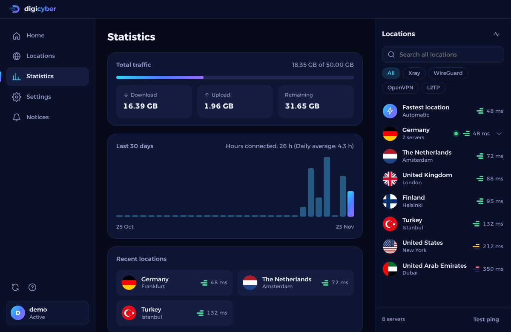
</p>
<p align="center">
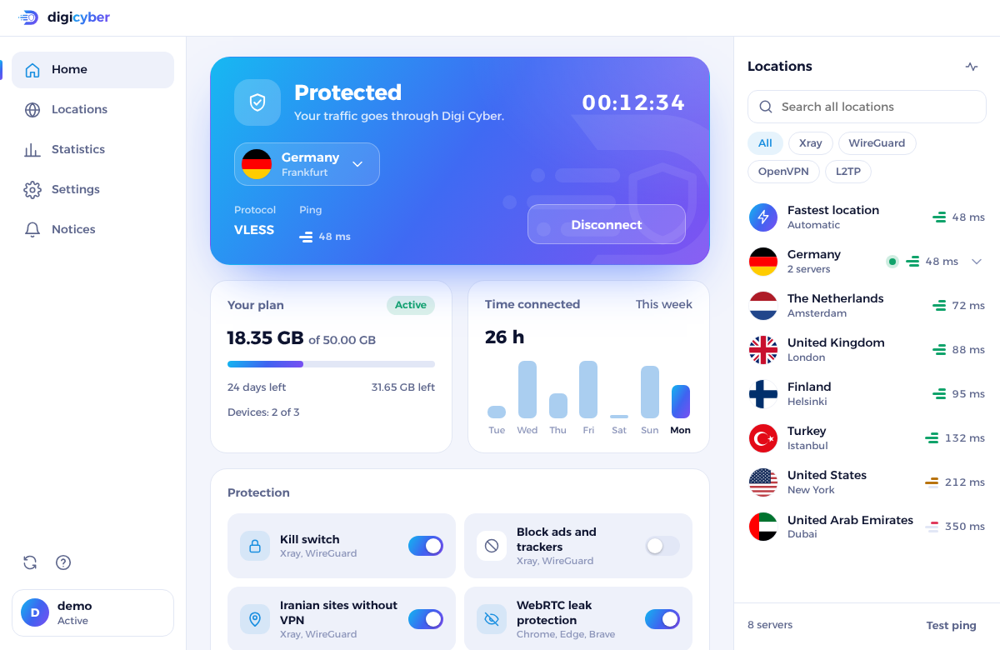
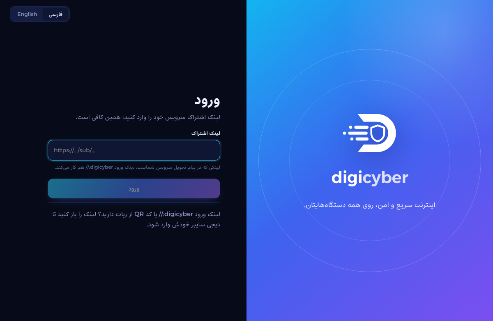
</p>

<p align="center">
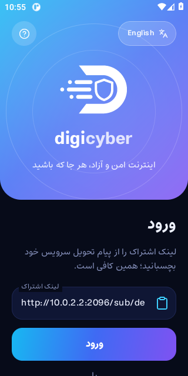
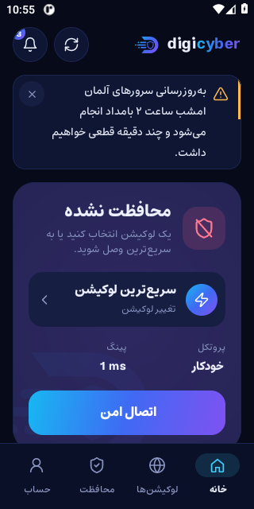
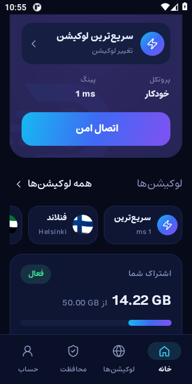
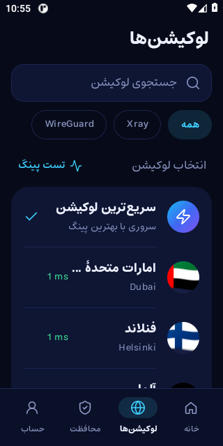
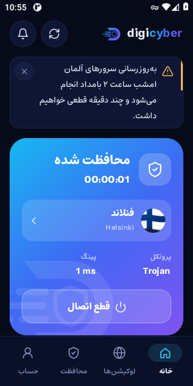
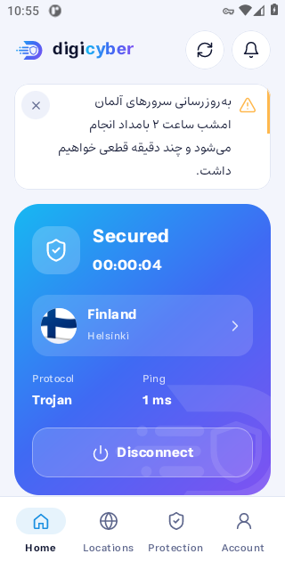
</p>

---

## English

**Digi Cyber** is a VPN app for Windows 10/11, macOS 12+, Linux and Android 5.0+. Paste the subscription link of your service and connect to the fastest server in one tap: no username needed. The download links above always give the newest version; every release lists the SHA-256 of each file in `SHA256SUMS.txt`.

Protocols: Xray (VLESS, VMess, Trojan, Shadowsocks, Hysteria 2), WireGuard, OpenVPN and L2TP/IPsec (Windows and Linux). Kill switch, split tunneling, Iranian sites without VPN, ad blocking, custom DNS, WebRTC leak protection and timezone matching. Persian and English, dark and light.

iPhone and iPad: there is no iOS app yet; use the subscription link in Streisand or Happ.

Open-source components and their licenses: [THIRD-PARTY.md](hub/THIRD-PARTY.md). Building the app: [docs/development.md](docs/development.md); running your own copy on GitHub: [docs/setup.md](docs/setup.md).
