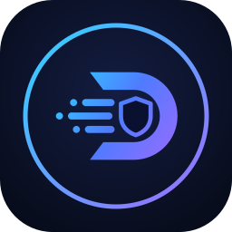

<p align="center">

</p>

<h1 align="center">Digi Cyber</h1>

<p align="center">
<a href="https://github.com/{{repo}}/releases/latest"></a>
<a href="https://github.com/{{repo}}/releases"></a>
</p>

<div dir="rtl">

<p align="center"><b>اپ VPN دیجی سایبر</b> برای ویندوز، اندروید، مک و لینوکس<br>فقط لینک اشتراک‌تان را وارد کنید و با یک لمس به سریع‌ترین سرور وصل شوید.</p>

## ⬇️ دانلود — نسخه‌ی {{version}}

| سیستم | دانلود | برای چه کسی |
| --- | --- | --- |
| 🪟 **ویندوز ۱۰ و ۱۱** (۶۴ بیتی) | [**Digi-Cyber-Setup.exe**]({{base}}/Digi-Cyber-Setup-{{version}}.exe) | همه‌ی کامپیوترهای ویندوزی |
| 🤖 **اندروید ۵ به بالا** | [**arm64-v8a**]({{base}}/Digi-Cyber-{{version}}-android-arm64-v8a.apk) | بیشتر گوشی‌های این چند سال |
| | [**universal**]({{base}}/Digi-Cyber-{{version}}-android-universal.apk) | اگر نمی‌دانید کدام را بگیرید (روی همه نصب می‌شود) |
| | [armeabi-v7a]({{base}}/Digi-Cyber-{{version}}-android-armeabi-v7a.apk) | گوشی‌های خیلی قدیمی |
| 🍎 **مک** با تراشه‌ی Apple (M1 و جدیدتر) | [**mac-arm64.pkg**]({{base}}/Digi-Cyber-{{version}}-mac-arm64.pkg) | macOS 12 به بالا |
| 🍎 **مک** اینتل | [mac-x64.pkg]({{base}}/Digi-Cyber-{{version}}-mac-x64.pkg) | macOS 12 به بالا |
| 🐧 **اوبونتو، دبیان، مینت، Pop!_OS** | [amd64.deb]({{base}}/Digi-Cyber-{{version}}-linux-amd64.deb) · [arm64.deb]({{base}}/Digi-Cyber-{{version}}-linux-arm64.deb) | |
| 🐧 **فدورا، RHEL، Rocky، AlmaLinux، openSUSE** | [x86_64.rpm]({{base}}/Digi-Cyber-{{version}}-linux-x86_64.rpm) · [aarch64.rpm]({{base}}/Digi-Cyber-{{version}}-linux-aarch64.rpm) | |
| 🐧 **آرچ، مانجارو، EndeavourOS** | [x64.pacman]({{base}}/Digi-Cyber-{{version}}-linux-x64.pacman) · [aarch64.pacman]({{base}}/Digi-Cyber-{{version}}-linux-aarch64.pacman) | |
| 📱 **آیفون و آیپد** | — | فعلاً نسخه‌ی iOS نداریم: لینک اشتراک را در **Streisand** یا **Happ** وارد کنید. |

<details>
<summary>فایل‌های دیگر اندروید (شبیه‌ساز و چند تبلت خاص)</summary>

| فایل | برای |
| --- | --- |
| [x86_64]({{base}}/Digi-Cyber-{{version}}-android-x86_64.apk) | شبیه‌سازهای اندروید روی کامپیوتر و چند تبلت با پردازنده‌ی اینتل |
| [x86]({{base}}/Digi-Cyber-{{version}}-android-x86.apk) | شبیه‌سازهای قدیمی |

</details>

**مک من کدام است؟** در منوی Apple گزینه‌ی **About This Mac** را بزنید: اگر جلوی Chip نوشته Apple M1 (یا M2، M3 و…)، فایل arm64 را بگیرید؛ اگر جلوی Processor نوشته Intel، فایل x64 را.

همه‌ی نسخه‌های قبلی در [صفحه‌ی Releases](https://github.com/{{repo}}/releases) هستند.

## 🛠 نصب

**ویندوز:** فایل را اجرا کنید. اگر ویندوز پیام «Windows protected your PC» داد، روی **More info** و بعد **Run anyway** بزنید (فقط بار اول).

**اندروید:** فایل APK را باز کنید و اجازه‌ی نصب از این منبع را یک بار بدهید. اگر Play Protect هشدار داد، اول **More details** و بعد **Install anyway** را بزنید.

**مک:** فایل pkg را باز کنید. بار اول macOS جلوی آن را می‌گیرد: در **System Settings** بخش **Privacy & Security** را باز کنید و دکمه‌ی **Open Anyway** را بزنید. برای پروتکل OpenVPN روی مک، OpenVPN را با Homebrew نصب کنید.

**لینوکس:** در ترمینال، در پوشه‌ای که فایل را دانلود کرده‌اید:

</div>

```bash
# Ubuntu / Debian / Mint
sudo apt install ./Digi-Cyber-{{version}}-linux-amd64.deb
# Fedora / RHEL   (openSUSE: sudo zypper install ...)
sudo dnf install ./Digi-Cyber-{{version}}-linux-x86_64.rpm
# Arch / Manjaro
sudo pacman -U ./Digi-Cyber-{{version}}-linux-x64.pacman
# macOS, OpenVPN only
brew install openvpn
```

<div dir="rtl">

## 🔑 ورود فقط با لینک اشتراک

نام کاربری لازم نیست. لینک اشتراکی را که در پیام تحویل سرویس گرفته‌اید در اپ بچسبانید و «ورود» را بزنید؛ اپ اکانت شما را خودش از روی اشتراک پیدا می‌کند. کد QR ورود و لینک‌های `digicyber://` هم کار می‌کنند.

هر پلنی که خریده‌اید با همان اشتراک در اپ کار می‌کند. هر دستگاه یکی از جاهای «تعداد دستگاه» اشتراک شما را می‌گیرد.

<!-- section:android -->
## 📸 تصاویر اندروید

{{gallery:android}}

<!-- /section -->
<!-- section:desktop -->
## 🖥 تصاویر ویندوز، مک و لینوکس

{{gallery:desktop}}

<!-- /section -->
## 🛡 دانلود امن

- فقط از **همین صفحه** یا لینکی که سرویس‌دهنده‌ی شما می‌فرستد دانلود کنید. فایلی که کسی در گروه یا کانال دیگری فرستاده ممکن است دستکاری شده باشد.
- کنار هر نسخه فایل [SHA256SUMS.txt]({{base}}/SHA256SUMS.txt) هست. عددی که دستور زیر برای فایل شما می‌دهد باید با عدد همان فایل در SHA256SUMS.txt یکی باشد.
- آدرس هیچ سروری داخل خود اپ نیست: سرورها، پروتکل‌ها و اطلاعیه‌ها فقط با لینک اشتراک خودتان می‌آیند.

</div>

```powershell
# Windows (PowerShell)
Get-FileHash .\Digi-Cyber-Setup-{{version}}.exe -Algorithm SHA256
```

```bash
# Linux
sha256sum Digi-Cyber-{{version}}-linux-amd64.deb
# macOS
shasum -a 256 Digi-Cyber-{{version}}-mac-arm64.pkg
```

<div dir="rtl">

## 🔒 حریم خصوصی

اپ برای ورود فقط لینک اشتراک، شناسه‌ی دستگاه، نام و نسخه‌ی سیستم عامل و نسخه‌ی اپ را می‌فرستد تا سقف دستگاه‌های اشتراک رعایت شود. گزارش خطا (لاگ) فقط وقتی فرستاده می‌شود که خودتان «گزارش مشکل» را بزنید، و رمزها، کلیدها و لینک‌ها پیش از ارسال از آن حذف می‌شوند.

## 💬 پشتیبانی

از «تماس با پشتیبانی» در خود اپ، یا از همان جایی که سرویس را خریده‌اید.

</div>

---

### English

Digi Cyber is a VPN app. Sign in with your subscription link alone, or scan its sign-in QR code.

| System | Download |
| --- | --- |
| Windows 10 / 11 (64-bit) | [Digi-Cyber-Setup-{{version}}.exe]({{base}}/Digi-Cyber-Setup-{{version}}.exe) |
| Android 5.0+ | [arm64-v8a]({{base}}/Digi-Cyber-{{version}}-android-arm64-v8a.apk) (most phones) · [universal]({{base}}/Digi-Cyber-{{version}}-android-universal.apk) (any) · [armeabi-v7a]({{base}}/Digi-Cyber-{{version}}-android-armeabi-v7a.apk) (older phones) |
| macOS 12+ | [Apple silicon]({{base}}/Digi-Cyber-{{version}}-mac-arm64.pkg) · [Intel]({{base}}/Digi-Cyber-{{version}}-mac-x64.pkg) |
| Debian / Ubuntu | [amd64]({{base}}/Digi-Cyber-{{version}}-linux-amd64.deb) · [arm64]({{base}}/Digi-Cyber-{{version}}-linux-arm64.deb) |
| Fedora / RHEL / openSUSE | [x86_64]({{base}}/Digi-Cyber-{{version}}-linux-x86_64.rpm) · [aarch64]({{base}}/Digi-Cyber-{{version}}-linux-aarch64.rpm) |
| Arch / Manjaro | [x64]({{base}}/Digi-Cyber-{{version}}-linux-x64.pacman) · [aarch64]({{base}}/Digi-Cyber-{{version}}-linux-aarch64.pacman) |
| iPhone / iPad | Not available: use your subscription link in Streisand or Happ. |

Checksums: [SHA256SUMS.txt]({{base}}/SHA256SUMS.txt) · Older versions: [Releases](https://github.com/{{repo}}/releases) · Open-source components: [THIRD-PARTY.md](THIRD-PARTY.md)

<p align="center"><sub>© Digi Cyber</sub></p>
